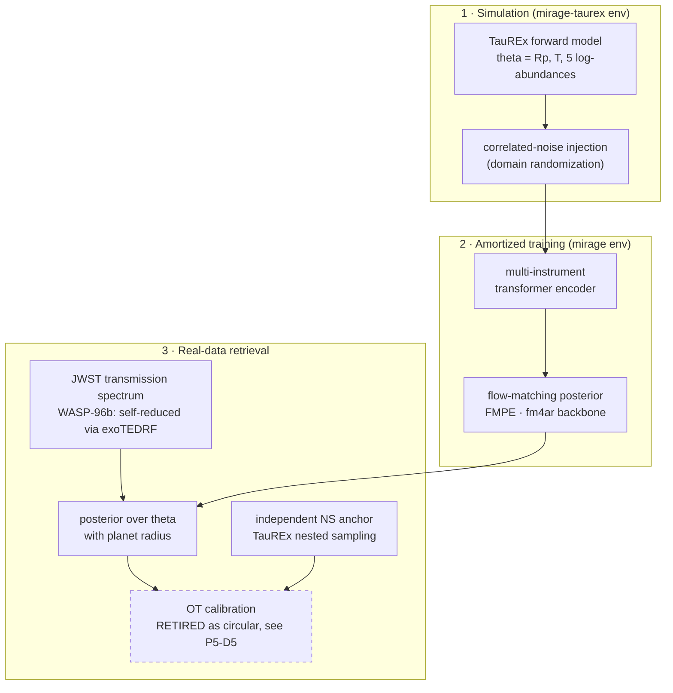

# MIRAGE
**Multi-Instrument Retrieval with Adaptive Generative Estimation**

[](https://arxiv.org/abs/2610.02245)
[](https://doi.org/10.5281/zenodo.21924294)
[](LICENSE)


> **A Missing Latent, Not a Missing Simulator: Radius-Augmented Inference for Real JWST Retrieval**
> Angshuman Chakravertty, P V V Raj
> [arXiv:2610.02245](https://arxiv.org/abs/2610.02245) (astro-ph.IM, cross-listed astro-ph.EP and cs.LG)

Simulation-to-real domain-adaptive atmospheric retrieval for JWST exoplanet transmission
spectroscopy.

---

## What this is

Amortized simulation-based inference trained on radiative-transfer simulators recovers exoplanet
atmospheres accurately on synthetic JWST spectra and then collapses on real reduced spectra.
MIRAGE is an end-to-end system, a multi-instrument transformer encoder plus a noise-conditioned
flow-matching posterior on the fm4ar backbone, built to diagnose *why* that collapse happens.

The central finding is a negative one about blame. On real WASP-39b the flow posterior collapsed
(importance-sampling ESS = 1, best-fit χ²/N = 301). That failure is normally attributed to missing
forward-model physics. Ruling those levers out with nested sampling first, a temperature gradient,
SO₂ opacity, and a high-fidelity ExoMolOP opacity set, left the fit unchanged. The cause was a
**missing latent, the planet radius**, which the simulator encodes but the inference omitted. With
no radius parameter the network could not absorb a roughly 3% transit-baseline mismatch.

Adding the planet radius to the inferred parameters takes best-fit χ²/N from **301 to 1.44** at a
fixed 1% error floor, a roughly 200x improvement. The transferable lesson is cross-domain: a latent
the simulator represents but the proposal omits can masquerade as simulator misspecification.

---

## Status, and what peer review changed

This repository records both the result and its corrections. Workshop review and a follow-up
self-audit retired two claims that appear in arXiv v1. They are listed here rather than quietly
dropped, because the corrected versions are what the code now supports.

| claim in v1 | current status |
|---|---|
| radius fix, χ²/N 301 → 1.44 → 0.66 at a stated floor | **holds**, the large effect is real |
| forward-model fidelity ruled out (T-gradient, SO₂, hi-fi opacities) | **holds** |
| WASP-96b self-reduced end to end from raw MAST | **holds** |
| "χ²/N 301 → 0.06" | **retired.** The two sides used different error floors, 5% for the flow and 1% for nested sampling. χ² scales as 1/σ², so this inflated the improvement about 25x. Corrected at a uniform 1% floor: 301 → 1.44 → 0.66, against a nested-sampling anchor of 0.76 (P5-D4) |
| optimal-transport calibration, coverage 7/7 | **retired as circular.** The Gaussian OT map transports the flow posterior onto the nested-sampling posterior, so coverage was measured against the very distribution the map targets. Measured: centre offset 0.46 σ_NS, width 2.08x NS, IS-ESS 12.4 of 6312. Intervals centred on the anchor and twice as wide cannot fail to contain it (P5-D5) |
| radii match published values on three targets | **narrowed to one.** Only WASP-96b's 68% interval contains the literature radius (P5-D7) |
| CycleGAN "did not improve on" structured randomization | **replaced by a stronger result.** The original comparison was invalid five ways, including a real domain that was one spectrum bootstrapped to 500 near-copies. Rebuilt on 3,241 genuine out-of-transit frames, translation is **worse than no adaptation at all** (P5-D11) |

Low importance-sampling ESS (1.00 to 42.5 out of 1000 to 6312 draws) means several intervals
reported in v1 are effectively point masses. Any interval quoted from a low-ESS arm is not a
credible interval. A v2 revision addressing this is in progress on `phase-6-track-1`.

Full evidence trail: [`Documentation/problems_and_decisions.md`](Documentation/problems_and_decisions.md)
(decision log, D1 to D13 and P3 to P5) and
[`Documentation/06_v2_post_rejection_plan.md`](Documentation/06_v2_post_rejection_plan.md).

---

## Multi-target results

One radius-inference method applied unchanged across three regimes, each retrieval validated
against an independent nested-sampling retrieval in the same parameter space. All χ² at a **1%
error floor**, the floor the nested-sampling anchors and the 301 baseline already use.


| Planet | Class | Instrument | Provenance | χ²/N | max resid | bins >3σ | radius 68% CI | literature | inside |
|---|---|---|---|---|---|---|---|---|---|
| WASP-39b | hot Saturn | NIRSpec PRISM | published | 0.66 | 1.60σ | 0/47 | [1.2263, 1.2345] | 1.279 | no |
| WASP-96b | hot Saturn | **NIRISS SOSS** | **self-reduced** | 0.77 | 2.45σ | 0/90 | [1.1924, 1.2012] | 1.200 | **yes** |
| K2-18b | cold sub-Neptune | NIRISS | published | 1.18 | 2.87σ | 0/149 | [0.2323, 0.2323] | 0.2352 | no |

Two things to read off this table honestly. The **spectral fits are good**, no bin on any target
exceeds 3σ and the 2σ counts sit at or below chance. The **radius intervals are not**, because
importance-weight collapse makes them far too narrow. On WASP-39b a single sample carries 99.95%
of the weight.

The strongest defensible real-data claim is therefore narrow and specific. On a spectrum reduced
end to end from raw MAST ramps (JWST ERO 2734, exoTEDRF plus a batman light-curve fit), the radius
is recovered to 0.1% with the literature value inside the 68% interval, and the 1.4 µm water
feature is recovered at 5.8σ. The other two targets give a plausible central value with an
overconfident interval.

---

## Domain adaptation, from the input side

Training spectra are domain-randomized with structured correlated noise (a white floor plus
squared-exponential and Ornstein-Uhlenbeck kernels), so the encoder meets realistic instrument
systematics before it meets real data.

A **CycleGAN domain-translation** variant was tested as the learned alternative. Measured against
3,241 genuine NIRSpec PRISM out-of-transit frames on WASP-39b:

| | sim, no adaptation | structured randomization | CycleGAN translation |
|---|---|---|---|
| MMD to real (lower better) | 0.2925 | **0.1704** | 0.7686 |
| KL to real (lower better) | 3.943 | **3.675** | 4.172 |
| mean shift (per-bin σ) | 0.030 | **0.033** | 0.308 |

Both metrics agree, and the informative comparison is against doing nothing. Structured
randomization improves on no adaptation while the learned translator is **2.6x worse than no
adaptation**, displacing the mean spectrum by roughly a third of a per-bin σ. So the result is not
the weak "translation adds nothing" but the stronger "translation actively moves the simulated
distribution away from the real one."

A cross-target version of this comparison is **not** reportable as evidence about targets. WASP-96b
has only 56 usable out-of-transit frames and K2-18b 96, and a control holding target and grid fixed
while varying only frame count showed the CycleGAN's MMD collapsing 71% purely from being scored
against fewer real points, while the other two arms moved under 1%.

---

## Noise conditioning, corrected

The published version of this result rested on baselines that never trained. Both no-conditioning
arms ran on the Mac's MPS backend and failed there. Retrained on CUDA at identical configs and
seeds, the synthetic win disappears and the real-data failure survives (P6-D1, P6-D2).

Mean ± sd over three training seeds. Coverage at 68% against known truth, nominal 0.68. For the
real column, lower JS means closer to the independent nested-sampling anchor.

| arm | ABC (6-param) | radius (7-param) | real, JS to NS anchor |
|---|---|---|---|
| no conditioning | 0.692 ± 0.013 | 0.692 ± 0.016 | **0.344 ± 0.003** |
| + σ + covariance | 0.698 ± 0.011 | 0.693 ± 0.014 | 0.426 ± 0.014 |

Every synthetic arm now sits at nominal, and the gaps between them are 0.1x to 0.5x the
training-seed spread. The earlier claim of "calibrates from either direction" needed a baseline
miscalibrated in two directions. That was the training failure, not a property of conditioning.

What survives is the transfer failure, and it is firmer than the synthetic result ever was.
Conditioning moves the real posterior 0.083 nats further from the anchor, which is 8.4x the seed
spread. The mechanism is a systematic bias rather than a calibration effect, with conditioning
driving the retrieved temperature to 1620 K against the anchor's 608 K.

**Retracted:** 0.587, 0.817, 0.687 and 0.700. **Withheld:** the +σ row, because
`noisecond_rad_sigma` is a third failed MPS run (best val 1.3729 where its family trains to 1.13)
and has not been retrained.

---

## Architecture



---

## Setup

Two environments, because the ML stack and the TauREx forward model have incompatible numpy pins:

```bash
# inference / training (torch, numpy 1.26, fm4ar backbone)
conda create -n mirage python=3.11 && conda activate mirage
pip install -r requirements.txt && pip install -e .        # installs the `mirage` package + fm4ar

# TauREx3 forward model / nested-sampling reference (numpy 2)
conda create -n mirage-taurex python=3.11 && conda activate mirage-taurex
pip install taurex numba

# (optional) JWST reduction, for reproducing the WASP-96b spectrum from raw MAST
conda create -n mirage-reduce python=3.11 && conda activate mirage-reduce
pip install exotedrf batman-package
```

Training entry point, from the repo root with no `PYTHONPATH` since both packages are pip-installed:

```bash
conda activate mirage && python scripts/train.py --experiment-dir configs/<name>
```

Multi-target retrieval and reduction pipeline:

```bash
# reduce WASP-96b from raw MAST -> transmission spectrum
conda run -n mirage-reduce python scripts/wasp96_setup_reduction.py
conda run -n mirage-reduce python scripts/wasp96_fit_lightcurves.py

# generate training data, train, evaluate on the real spectrum
python scripts/generate_training_data.py --planet wasp96 --tprofile radius --nbins 90 ...
python scripts/train.py --experiment-dir configs/noisecond_rad_nocond_wasp96
bash    scripts/run_wasp96_eval.sh
```

Reproducing the reported numbers:

```bash
python scripts/multitarget_table.py        # Table 2 at a stated error floor, with ESS warnings
python scripts/transfer_table.py           # synthetic coverage + real JS, both IS-free
python scripts/fig_multitarget_v2.py       # Figure 2 with the full error budget
bash   scripts/run_cyclegan_tiers.sh       # the translation-vs-randomization comparison
python scripts/cyclegan_tier_table.py      # its summary table
```

---

## Structure

```
Project/
├── mirage/            # the MIRAGE package: nn/ (encoder, covariance embedding),
│                      #   datasets/ (noise injection, real-JWST adapter), register.py
│                      #   (monkeypatches the pristine fm4ar factories, see P2-D8)
├── scripts/           # forward model (taurex_forward.py), retrieval (taurex_retrieve.py),
│                      #   data generation, real-data eval, OT calibration, figures,
│                      #   WASP-96b reduction (wasp96_setup_reduction / wasp96_fit_lightcurves)
├── configs/           # per-experiment YAML + checkpoints (checkpoints gitignored)
├── data/              # gitignored, downloaded / generated locally
├── figures/           # evaluation figures (regenerable)
├── Documentation/     # phase docs + problems_and_decisions.md (the decision log)
└── fm4ar/             # pristine upstream backbone, pinned; cloned locally (gitignored)
```

---

## Data and artifacts

Large data and model checkpoints are not stored in the repository (`data/` and
`configs/**/model__*.pt` are gitignored). Synthetic training data is generated locally via
`scripts/generate_training_data.py`. Real JWST observations, published transmission spectra, and
opacities are sourced as described in [`ACKNOWLEDGEMENTS.md`](ACKNOWLEDGEMENTS.md).

A companion **Zenodo record** ([10.5281/zenodo.21924294](https://doi.org/10.5281/zenodo.21924294))
archives the reproducible artifacts: the three reduced transmission spectra including the
self-reduced WASP-96b spectrum, the trained FMPE models and configs, and the MIRAGE and
nested-sampling posterior samples behind the multi-target results.

---

## Phases

| Phase | Focus | Status |
|-------|-------|--------|
| 0 | Environment + baseline reproduction | Complete |
| 1 | Multi-instrument transformer encoder | Complete |
| 2 | Noise conditioning (covariance embedding) | Complete, ABC calibration win |
| 3 | Real JWST integration | Complete, radius fix |
| 4 | Full evaluation + benchmark + figures | Complete |
| 5 | Multi-target (N=3) + higher-res + Zenodo release | Complete, arXiv v1 posted |
| 6 | v2 revision: claim repairs, honest intervals | In progress |

**Tracks.** MIRAGE attacks the sim-to-real gap from two sides, developed on separate branches and
merged at phase boundaries.

- **Track 1, inference.** The radius-augmented flow-matching posterior, the multi-target (N=3)
  retrieval, the end-to-end WASP-96b self-reduction, and the claim audits in P5.
- **Track 2, domain adaptation and data.** Structured domain randomization, the JWST data-handling
  pipeline, and the translation-versus-randomization study.

---

## Citation

```bibtex
@misc{chakravertty2026mirage,
  title        = {A Missing Latent, Not a Missing Simulator: Radius-Augmented
                  Inference for Real JWST Retrieval},
  author       = {Chakravertty, Angshuman and Raj, P V V},
  year         = {2026},
  eprint       = {2610.02245},
  archivePrefix= {arXiv},
  primaryClass = {astro-ph.IM},
  doi          = {10.48550/arXiv.2610.02245},
  url          = {https://arxiv.org/abs/2610.02245}
}
```
