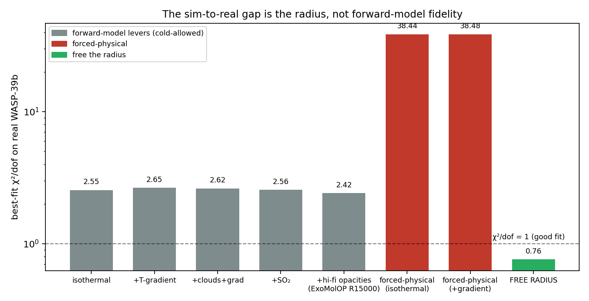
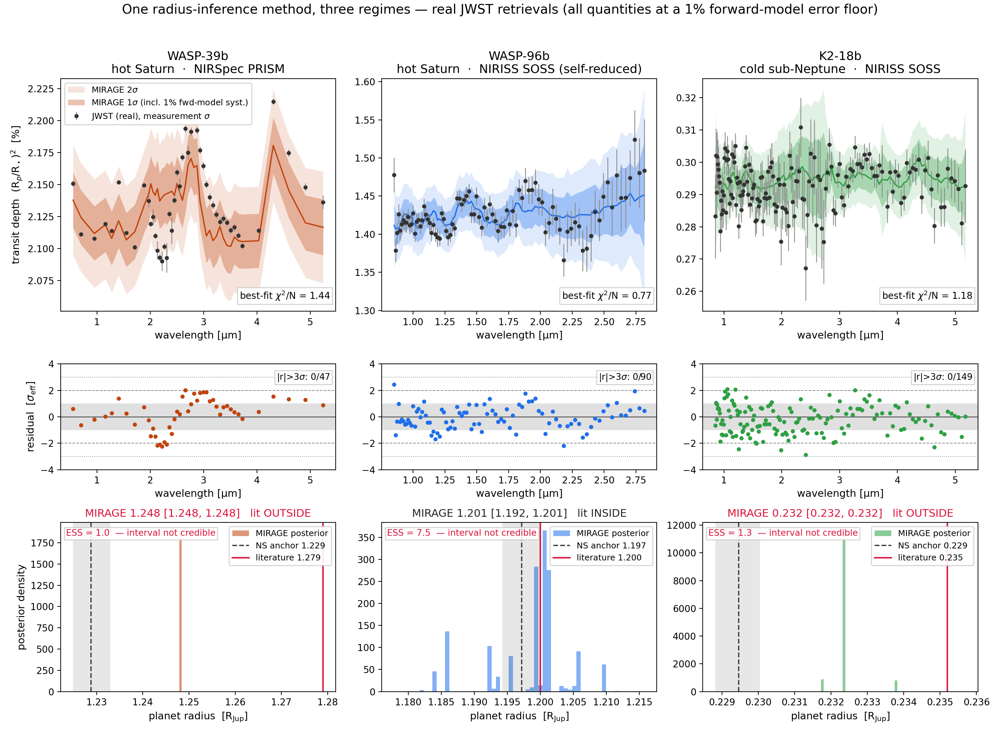
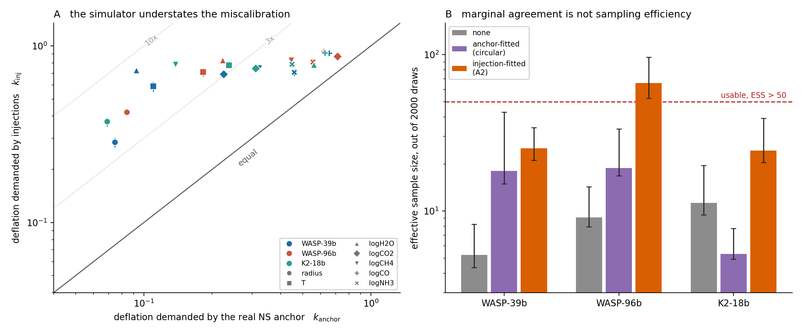
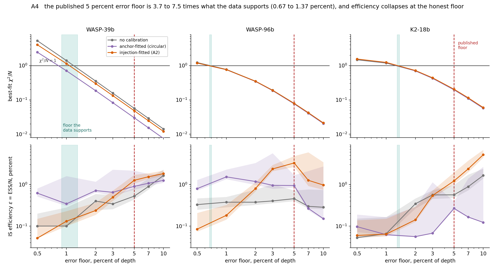
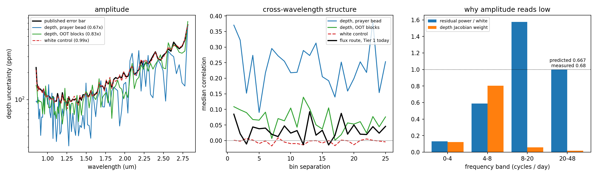
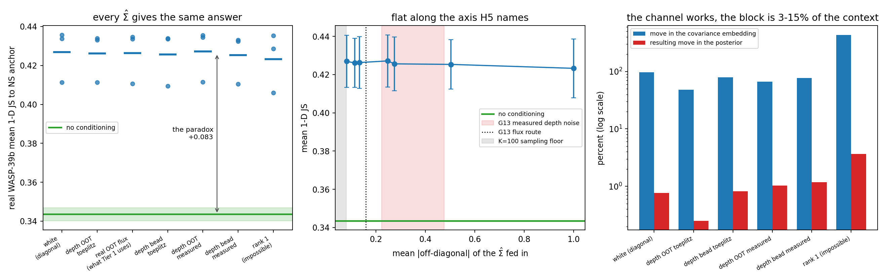
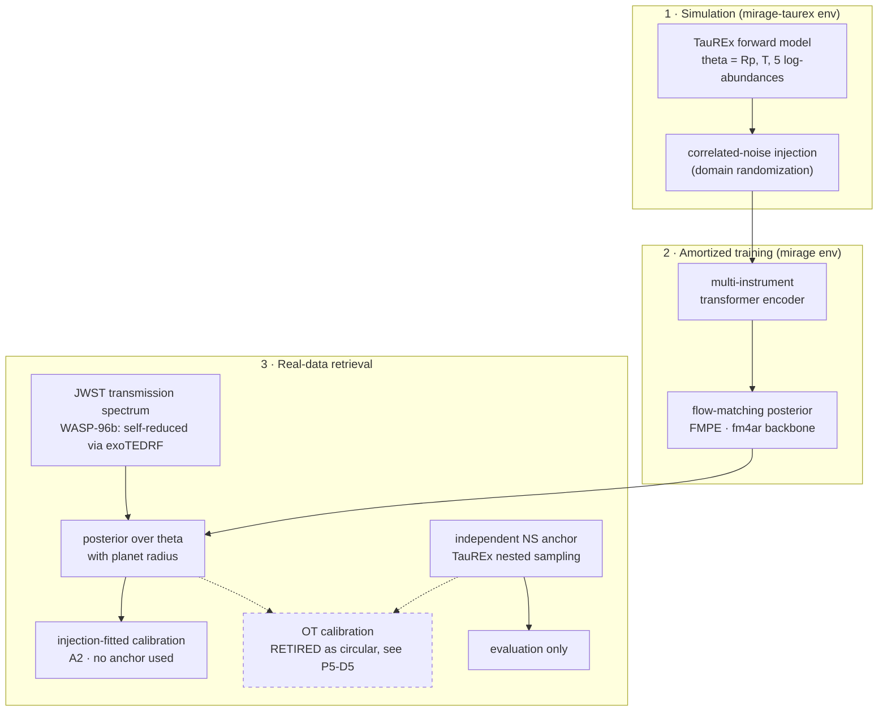

# MIRAGE
**Multi-Instrument Retrieval with Adaptive Generative Estimation**

[](https://arxiv.org/abs/2610.02245)
[](https://doi.org/10.5281/zenodo.21924294)
[](LICENSE)


> **A Missing Latent, Not a Missing Simulator: Radius-Augmented Inference for Real JWST Retrieval**
> Angshuman Chakravertty, P V V Raj
> [arXiv:2610.02245](https://arxiv.org/abs/2610.02245) (astro-ph.IM, cross-listed astro-ph.EP and cs.LG)

Simulation-to-real domain-adaptive atmospheric retrieval for JWST exoplanet transmission
spectroscopy.

---

## What this is

Amortized simulation-based inference trained on radiative-transfer simulators recovers exoplanet
atmospheres accurately on synthetic JWST spectra and then collapses on real reduced spectra.
MIRAGE is an end-to-end system, a multi-instrument transformer encoder plus a noise-conditioned
flow-matching posterior on the fm4ar backbone, built to diagnose *why* that collapse happens.

---

## The arc, in one place

This repository is unusual in that it records a result, the peer review that broke parts of it,
and the follow-up work that replaced them. That history is the point, so it is told in order
rather than tidied away.

**1. The original finding (Phases 0 to 5, arXiv v1).** On real WASP-39b the flow posterior
collapsed, importance-sampling ESS of 1 and best-fit χ²/N of 301. That failure is normally
blamed on missing forward-model physics. Ruling those levers out with nested sampling first, a
temperature gradient, SO₂ opacity, clouds, and a high-fidelity ExoMolOP opacity set, left the fit
unchanged. The cause was a **missing latent, the planet radius**, which the simulator encodes but
the inference omitted. With no radius parameter the network could not absorb a roughly 3%
transit-baseline mismatch. Freeing it takes χ²/N from 301 to 1.44.

**2. Review broke two headlines (Phase 5 audit).** A workshop rejection and a self-audit retired
the optimal-transport calibration as circular and narrowed the radius-recovery claim from three
targets to one. The χ² improvement had also been inflated about 25x by comparing two sides at
different error floors. Details in the table below.

**3. The repair work (Phase 6, current).** Rather than delete the retired claims, I rebuilt the
machinery behind them without the circularity and measured what was actually there. That turned
a negative into the project's quantitative core: the sim-to-real gap is now a measured quantity
rather than an assertion, and the error budget that made importance sampling look workable is
now known to be inflated.

**Where it stands.** The radius result holds and is large. The calibration does not survive as a
repair, and the honest version of it is a measurement of how far the simulator sits from reality.
All Track 1 experimental work is complete except one item blocked on a build. The v2 manuscript
is the remaining deliverable.

---

## What holds and what was retired

| claim in arXiv v1 | current status |
|---|---|
| radius fix, χ²/N 301 → 1.44 | **holds.** The large effect is real and reproduces at a uniform floor |
| forward-model fidelity ruled out (T-gradient, SO₂, hi-fi opacities) | **holds**, and strengthened. TauREx and petitRADTRANS agree to 0.07σ on the same spectrum (P6-D19) |
| WASP-96b self-reduced end to end from raw MAST | **holds** |
| nested-sampling anchor is trustworthy | **holds.** Stable across 150 to 1000 live points, radius width ratio 1.04x (P6-D18) |
| "χ²/N 301 → 0.06" | **retired.** The two sides used different error floors, 5% for the flow and 1% for nested sampling. χ² scales as 1/σ², inflating the improvement about 25x (P5-D4) |
| optimal-transport calibration, coverage 7/7 | **retired as circular.** The Gaussian OT map transports the flow posterior onto the nested-sampling posterior, so coverage was measured against the distribution the map targets. Intervals centred on the anchor and twice as wide cannot fail to contain it (P5-D5) |
| radii match published values on three targets | **narrowed to one.** Only WASP-96b's 68% interval contains the literature radius (P5-D7) |
| CycleGAN "did not improve on" structured randomization | **replaced by a stronger result.** The original comparison was invalid five ways, including a real domain that was one spectrum bootstrapped to 500 near-copies. Rebuilt on 3,241 genuine out-of-transit frames, translation is **worse than no adaptation at all** (P5-D11) |

Low importance-sampling ESS means several intervals reported in v1 are effectively point masses.
**Any interval quoted from a low-ESS arm is not a credible interval.** Phase 6 has since made
that statement precise rather than cautionary, see the error-budget section.

Full evidence trail: [`Documentation/problems_and_decisions.md`](Documentation/problems_and_decisions.md),
64 numbered entries from D1 through P6-D23.

---

## The radius fix



Every forward-model lever leaves the fit at χ²/N near 2.5. Forcing physical consistency without a
free radius makes it worse, 38.4. Freeing the radius alone takes it to 0.76. The transferable
lesson is cross-domain: **a latent the simulator represents but the proposal omits can masquerade
as simulator misspecification.**

> Two numbers travel together here and are easy to confuse. This figure is the **nested-sampling**
> lever study, where freeing the radius gives 0.76, and that run is also the anchor the flow is
> compared against. The **flow** posterior with the radius freed gives 1.44, which is the number in
> the multi-target table below. The retired 0.66 was the flow after OT calibration.

---

## Multi-target retrievals

One radius-inference method applied unchanged across three regimes, each validated against an
independent nested-sampling retrieval in the same parameter space. All quantities at a **1% error
floor**, which Phase 6 later vindicated as close to what the data actually supports.



**Fit quality.** These are good, and the reviewer objection that they were not was a plotting
defect rather than a fit defect (P5-D7).

| Planet | Class | Instrument | Provenance | χ²/N | max resid | bins >2σ | bins >3σ |
|---|---|---|---|---|---|---|---|
| WASP-39b | hot Saturn | NIRSpec PRISM | published | 1.44 | 2.26σ | 5/47 | **0/47** |
| WASP-96b | hot Saturn | **NIRISS SOSS** | **self-reduced** | 0.77 | 2.45σ | 1/90 | **0/90** |
| K2-18b | cold sub-Neptune | NIRISS SOSS | published | 1.18 | 2.87σ | 8/149 | **0/149** |

No bin on any target exceeds 3σ and the 2σ counts sit at or below chance expectation.

**Radius intervals.** These are the weak part, and the answer depends on which interval you
quote, so both are given. ESS is out of 1000 draws.

| Planet | ESS | IS-weighted 68% | lit inside | IS-free 68% | lit inside | literature |
|---|---|---|---|---|---|---|
| WASP-39b | 1.00 | point mass, withheld | no | [1.1417, 1.2841] | yes | 1.279 |
| WASP-96b | 7.49 | [1.1924, 1.2012] | **yes** | [1.1568, 1.2234] | yes | 1.200 |
| K2-18b | 1.31 | [0.2323, 0.2323] | no | [0.2189, 0.2363] | yes | 0.235 |

**Importance-weight collapse is what makes this awkward.** At the 1% floor a single sample carries
99.95% of the weight on WASP-39b and 87% on K2-18b, so the IS-weighted "posteriors" are point
masses with essentially zero width. On those intervals the literature radius lands inside for
WASP-96b only, which is the P5-D7 result. The IS-free intervals are the raw flow at equal weights,
which cannot collapse, and the literature value sits inside all three. But they are 7.6x to 1700x
wider and carry no likelihood information, so they are a fallback for a collapsed arm rather than
a stronger result. **Neither row should be quoted without saying which it is.**

The strongest defensible real-data claim is therefore narrow and specific. On a spectrum reduced
end to end from raw MAST ramps (JWST ERO 2734, exoTEDRF plus a batman light-curve fit), the radius
is recovered to 0.1% with the literature value inside the 68% interval, and the 1.4 µm water
feature is recovered at 5.8σ. The other two targets give a plausible central value with an
overconfident interval.

> χ²/N here is the radius-augmented posterior with no calibration applied. Earlier versions of
> this table quoted 0.66 for WASP-39b, which came from the OT calibration that P5-D5 retired.

---

## Phase 6, part 1: the sim-to-real gap, measured

The retired OT calibration was fitted on each target's own nested-sampling anchor. Two
replacements were tested. Transferring one target's calibration to another fails (H11, P6-D21),
recovering 2.5% of the benefit it shows on the target it was fitted to. Fitting the calibration on
**injection labels instead**, with no nested sampling anywhere in the estimator, works (A2,
P6-D22) and turns the exercise into a measurement.



Writing `k` for the width deflation a posterior needs and `s` for its bias in flow-sd units, both
measurable against injections and against the real anchor in the same units:

| target | median k ratio, injections vs real | worst parameter | bias gap, true-posterior σ |
|---|---|---|---|
| WASP-39b | 3.06x | logH2O 7.85x | 0.05 vs 2.18, **47x** |
| WASP-96b | 1.85x | radius 5.02x | 0.04 vs 0.74, **18x** |
| K2-18b | 2.39x | logCH4 5.67x | 0.16 vs 1.26, **8x** |

**No point on any target falls below the diagonal.** The simulator reproduces the *direction* of
the miscalibration and badly understates its *size*. Radius is the worst or near-worst parameter
on all three, which is consistent with the radius being the fix in the first place.

**The gap is not the noise amplitude.** Re-fitting at training-range noise, then published noise,
then the real anchor gives median k of 0.916, 0.712, 0.225. Noise amplitude accounts for under a
fifth. With the forward model already cleared at 0.07σ, the residual narrows to real-spectrum
information content, reduction systematics, or cloud and vertical-structure physics.

A2 is **not** a repair. It recovers roughly a seventh of the circular calibration's apparent gain.
The remaining 80 to 90% was never calibration.

---

## Phase 6, part 2: the error budget

Every ESS number in this project was computed at one error floor, 5%, inherited from the published
pipeline and never justified. The floor enters the likelihood only through
`se = sqrt(σ² + (floor·x)²)`, so sweeping it re-weights forwards that already exist (A4, P6-D23).



| target | floor where best-fit χ²/N reaches 1 | published floor is larger by |
|---|---|---|
| WASP-39b | 0.89 to 1.30% | 3.8 to 5.6x |
| WASP-96b | 0.67 to 0.70% | 7.1 to 7.5x |
| K2-18b | 1.30 to 1.37% | 3.6 to 3.8x |

**The published 5% floor is 4 to 7 times what the data supports**, and at 5% the best-fit χ²/N
sits at 0.03 to 0.20, meaning the best available model is five to thirty times "too good" for its
stated errors. **At the floor the data supports, importance sampling fails for every arm on every
target**, efficiency 0.06 to 1.52% of draws.

This settles an open question in the other direction too. The flow pipeline used 5% while the
nested-sampling anchor used 1%. The floor the data supports brackets the anchor's 1% and excludes
the flow's 5%, so the anchor's error budget was right.

It also qualifies A2 above: A2's *efficiency* advantage holds only at floors of 3% and up, while
A2's *measurement* contains no floor at all and is untouched.


---

## Phase 6, part 3: is the injected noise the right noise?

Tier-1 injections contaminate simulated spectra with noise built from real out-of-transit frames.
Those frames are *flux*, and a transit depth is not a flux, so the construction could not carry
anything the light-curve fit itself introduces. G13 logged that gap in Phase 5. Settling it needs
the fit re-run on data with a known injected depth, which is possible only on WASP-96b, where the
exoTEDRF reduction and the batman fit are mine end to end (A1 completion, P6-D25).



| arm | σ vs published bar | mean abs off-diagonal | top eigenvalue | common mode |
|---|---|---|---|---|
| depth, prayer bead | 0.67x | 0.476 | 45.0 | 0.039 |
| depth, OOT blocks | 0.83x | 0.223 | 15.0 | 0.040 |
| white-noise control | **0.99x** | 0.047 | 2.4 | 0.009 |
| flux route, Tier 1 today | 1.00x by construction | 0.159 | 7.4 | 0.026 |

**The first reading of that table is wrong, and the control is what catches it.** Both depth
constructions land below the published error bar, which looks like a finding that the bars are
conservative. White noise at the same residual scatter, through the identical fit, recovers the
published bar to 0.99x. The shortfall belongs to the construction: prayer-bead resamples *fit*
residuals, and exoTEDRF's detrending plus the four parameters the fit removes have already taken
power out at exactly the transit timescale. That is predictable in closed form from the residuals'
own power spectrum, **0.667 predicted against 0.677 measured**.

**So the approximation is right on amplitude and wrong on structure.** Depth noise correlates
across wavelength 1.4x to 3x more strongly than the flux route, and it carries a 31 to 37 ppm
near-uniform common-mode depth offset. That offset is a free transit-depth baseline, which is the
latent H10 proposes and the thing the floating radius stands in for, measured here in the pipeline
rather than inferred from a posterior.

Two honest limits. The two depth pools bracket rather than agree, 0.67x against 0.83x with
disjoint intervals. And the structure comparison confounds method with provenance, since the depth
route uses the 280-frame self-reduction and the flux route the 56-frame published table, so the
gap is an upper bound on what the method alone contributes. WASP-39b and K2-18b keep the flux
approximation, and the paper says so.


## Domain adaptation, from the input side (Track 2)

Training spectra are domain-randomized with structured correlated noise, a white floor plus
squared-exponential and Ornstein-Uhlenbeck kernels, so the encoder meets realistic instrument
systematics before it meets real data.

Measured against 3,241 genuine NIRSpec PRISM out-of-transit frames on WASP-39b, scored on
held-out real frames over three seeds (P6-D13):

| arm | MMD to real | KL to real |
|---|---|---|
| no adaptation | 0.2883 | 3.33 |
| per-bin affine | 0.2883 | 3.33 |
| structured randomization | 0.1682 | 3.31 |
| classifier reweighting | 0.1459 | 2.33 |
| **per-bin quantile mapping** | **0.1056** | **0.89** |
| CycleGAN translation | 0.7823 | 3.33 |

Three results here. **The learned translator is 2.7x worse than doing nothing**, so the claim is
not the weak "translation adds nothing" but the stronger "translation actively moves the simulated
distribution away from the real one". **A per-bin CDF transfer with no learning loop beats
everything**, including structured randomization. And **per-bin affine is identical to no
adaptation by construction**, because the metric standardises per bin and therefore cannot see an
affine map, so that arm is untestable in this space rather than null.

**This is distributional only, and must not be read as a retrieval result.** A per-bin marginal
match can be achieved by a map that destroys the parameter information a retrieval reads. That
caution is the same dissociation Track 1 measured directly on the inference side, where the
circular calibration scores excellent marginal agreement and unusable sampling on the same object.

A cross-target version is **not** reportable. WASP-96b has 56 usable out-of-transit frames and
K2-18b has 96, and a control varying only frame count showed the CycleGAN's MMD collapsing 71%
purely from being scored against fewer real points.

---

## Noise conditioning, corrected

The published version of this result rested on baselines that never trained. Both no-conditioning
arms ran on the Mac MPS backend and failed there. Retrained on CUDA at identical configs and
seeds, the synthetic win disappears and the real-data failure survives (P6-D1, P6-D2, P6-D12).

Mean ± sd over three training seeds. Coverage at 68% against known truth, nominal 0.68.

| arm | ABC (6-param) | radius (7-param) | real, JS to NS anchor |
|---|---|---|---|
| no conditioning | 0.692 ± 0.013 | 0.692 ± 0.016 | **0.344 ± 0.003** |
| + σ + covariance | 0.698 ± 0.011 | 0.693 ± 0.014 | 0.426 ± 0.014 |

Every synthetic arm now sits at nominal and the gaps between them are 0.1x to 0.5x the
training-seed spread. The earlier claim of "calibrates from either direction" needed a baseline
miscalibrated in two directions, and that was the training failure.

What survives is the transfer failure. Conditioning moves the real posterior 0.083 nats further
from the anchor, 8.4x the seed spread, driving retrieved temperature to 1620 K against the
anchor's 608 K. Against injection labels conditioning is *mildly better* calibrated, 1.6x to 2.9x
the seed spread, so the two results are not equal and opposite and the paper carries both with
effect sizes attached (P6-D11).

---

## Phase 6, part 4: the conditioning paradox is real

The flow has an arm that reads the noise: it ingests out-of-transit frames, estimates a
covariance, and conditions on it. On real WASP-39b that arm is **worse** than the one that reads
nothing, mean 1-D JS to the nested-sampling anchor 0.426 against 0.344 over three training seeds,
a gap 8.4x the seed spread. Better information about the noise makes the answer worse. H5 blamed
the proxy, since the covariance is estimated from *flux* and the quantity that matters is *depth*,
and the section above measured that those differ (A3, P6-D26).



| Σ̂ fed to the covariance arm | correlation fed in | mean JS |
|---|---|---|
| white, diagonal errors | 0.082 | 0.427 |
| real out-of-transit flux, what Tier 1 uses | 0.134 | 0.426 |
| depth OOT blocks, measured matrix | 0.247 | 0.427 |
| depth prayer bead, measured matrix | 0.504 | 0.425 |
| rank 1, physically impossible | 1.000 | 0.423 |
| **no conditioning at all** | — | **0.344** |

**Nothing moves it.** The span across every Σ̂ tried is 0.0039 against a seed spread of 0.0137 and
a paradox of 0.0827, so the noise proxy accounts for at most 4.7% of the effect, and that bound
comes from an input no instrument could produce. Across realistic inputs it is 2.2%. The
temperature sits near 1620 K under every input, against the anchor's 608 K. The depth probes
carry the measured correlation across from the section above, and the stronger one is fed at
0.504 against the 0.476 that was measured, so the regime is covered from inside the measurement
rather than only from the impossible bound.

**The obvious deflationary reading is that the model ignores the channel. It does not.** The
covariance embedding moves by 97% of its own norm when the input switches from real frames to
white noise. What it cannot do is matter, because that block has norm 0.419 beside the spectrum
block's 10.910, so it is **3 to 6% of the context** across realistic inputs. Even the rank-1
input, which inflates the block four-fold to 15% of the context, shifts the posterior by 0.003.
The channel is well built, verifiably scale-free, responsive to its input, and architecturally
incapable of carrying the effect it exists to carry.

So the paradox is not an artifact of how the noise was estimated. Conditioning at this scale is
an architectural change that costs real-data accuracy, and the noise information is not the
reason. Three checks make that readable. The real-frames row reproduces the published numbers
exactly on all three seeds. Feeding the same frames scaled by ten changes the answer by 0.0000.
And the comparison is exactly paired, because the sampler reseeds from each arm's own config, so
every row starts from a byte-identical draw and only the context differs.

This tests conditioning at inference. Whether a model *trained* on depth-noise Σ̂ behaves
differently is untested and would need a retrain.

---

## Current state

Phase 6 is the v2 revision. Work is split across two tracks on separate branches, merged at phase
boundaries.

**Track 1, inference** (`phase-6-track-1`). The radius-augmented posterior, multi-target
retrieval, the WASP-96b self-reduction, the claim audits, and the Phase 6 repairs.

| item | what | status |
|---|---|---|
| A1 | Tier-1 injections with SBC, TARP, HPD coverage | **done** (P6-D8, P6-D11), G13 closed (P6-D25) |
| A2 | Rebuild the calibration on injection labels | **done**, all three targets (P6-D22) |
| A3 | H5, the noise-proxy test | **done** (P6-D26). Negative, and it is the headline |
| A4 | H3, the error-floor sweep | **done** (P6-D23) |
| A5 | NS anchor stability, and TauREx vs petitRADTRANS | **done** (P6-D18, P6-D19) |
| A6 | Manuscript, inference side | blueprint **done** (P6-D20) |

**Track 2, domain adaptation and data** (`v2-track-2`). Structured randomization, the JWST
data-handling pipeline, the translation study, and related work.

| item | what | status |
|---|---|---|
| V2 | Cheap baselines any learned translator must beat | distributional half **done** (P6-D13), inferential half open |
| V5 | Tier-2 verification, multiple reductions of one visit | **done** (P6-D14). K2-18b G395H is the usable test, WASP-39b is not |
| V6 | Related work, and relabel the old ablation script | **done** |
| V7 | Rebuild the CycleGAN real side on all three spectra | built and smoke-tested, **not run** (P6-D16) |
| V3 | H1 as a mechanism check | built and smoke-tested, **not run** (P6-D16) |
| V1b | Score the translated arm on the A1 injection ladder | build and first result **done** (P6-D24), interpretation open |

**What is left.** On Track 1, every experiment is closed and fig5 was rebuilt on the eighteen
device-matched H9 arms on 2026-11-18 (P6-D27), which completed A1. The optional
σ-range retrain is also **done** (P6-D28, trained on a Kaggle T4 on 2026-11-19): it did not fix the
conditioning paradox, it widened it, the cov arm's real-data JS rising from 0.427 to 0.490 while
no-cond held at 0.342. What remains is the v2 manuscript. On Track 2, running V7 and V3 now that the spectra they need are in the repository,
the inferential half of V2, and the V1b write-up. arXiv v2 goes last, by decision (P6-D10).

---

## Architecture



The anchor is now used for **evaluation only**. The calibration path that consumed it is retired,
and its anchor-free replacement is fitted on injections.

---

## Setup

Three environments, because the ML stack, the TauREx forward model, and the JWST reduction tools
have incompatible numpy pins:

```bash
# inference / training (torch, numpy 1.26, fm4ar backbone)
conda create -n mirage python=3.11 && conda activate mirage
pip install -r requirements.txt && pip install -e .        # installs the `mirage` package + fm4ar

# TauREx3 forward model / nested-sampling reference (numpy 2)
conda create -n mirage-taurex python=3.11 && conda activate mirage-taurex
pip install taurex numba

# (optional) JWST reduction, for reproducing the WASP-96b spectrum from raw MAST
conda create -n mirage-reduce python=3.11 && conda activate mirage-reduce
pip install exotedrf batman-package
```

**Which environment runs what.** Anything that calls TauREx, including every forward model and
every nested-sampling anchor, needs `mirage-taurex`. Everything else runs in `mirage`. Running
`scripts/taurex_forward.py` under `mirage` fails with `ModuleNotFoundError: No module named
'taurex'`.

Training entry point, from the repo root with no `PYTHONPATH` since both packages are pip-installed:

```bash
conda activate mirage && python scripts/train.py --experiment-dir configs/<name>
```

Multi-target retrieval and reduction pipeline:

```bash
# reduce WASP-96b from raw MAST -> transmission spectrum
conda run -n mirage-reduce python scripts/wasp96_setup_reduction.py
conda run -n mirage-reduce python scripts/wasp96_fit_lightcurves.py

# generate training data, train, evaluate on the real spectrum
python scripts/generate_training_data.py --planet wasp96 --tprofile radius --nbins 90 ...
python scripts/train.py --experiment-dir configs/noisecond_rad_nocond_wasp96
bash    scripts/run_wasp96_eval.sh
```

Reproducing the reported numbers:

```bash
# v1 results
python scripts/multitarget_table.py        # multi-target table at a stated floor, with ESS warnings
python scripts/transfer_table.py           # synthetic coverage + real JS, both IS-free
python scripts/fig_multitarget_v2.py       # the multi-target figure with the full error budget

# Phase 6
python scripts/a2_validate_estimator.py    # validate the injection estimator against planted (s, k)
python scripts/a2_inject_calibrate.py --moments --planet wasp39   # then --fit --apply --score
python scripts/a4_floor_sweep.py           # error-floor sweep, re-weights stored forwards only
python scripts/h11_ot_transfer.py          # calibration transfer matrix
python scripts/fig_a2_injection.py && python scripts/fig_a4_floor.py
```

---

## Structure

```
Project/
├── mirage/            # the MIRAGE package: nn/ (encoder, covariance embedding),
│                      #   datasets/ (noise injection, real-JWST adapter), register.py
│                      #   (monkeypatches the pristine fm4ar factories, see P2-D8)
├── scripts/           # forward model (taurex_forward.py), retrieval (taurex_retrieve.py),
│                      #   data generation, real-data eval, Phase 6 analyses (a2_*, a4_*, h11_*),
│                      #   figures (fig_*.py, make_figures.py), WASP-96b reduction
├── configs/           # per-experiment YAML + checkpoints
├── data/              # gitignored except the three reduced spectra. Numeric artifacts
│                      #   (.npz, .json) only, no images
├── figures/           # EVERY figure, from every script. Mostly gitignored; figures
│                      #   embedded in this README are explicitly un-ignored so they render
├── Documentation/     # phase docs + problems_and_decisions.md (the decision log)
└── fm4ar/             # pristine upstream backbone, pinned; cloned locally (gitignored)
```

**Figure convention.** Analysis scripts write their numbers into `data/<item>/` and their pictures
into `figures/`. If you embed a new figure in this README, add it to the un-ignore list in
`.gitignore` or it renders as a broken image for everyone who clones.

---

## Data and artifacts

Large data and model checkpoints are mostly not stored in the repository. The three reduced
transmission spectra are tracked because both tracks need them. Synthetic training data is
generated locally via `scripts/generate_training_data.py`. Real JWST observations, published
transmission spectra, and opacities are sourced as described in
[`ACKNOWLEDGEMENTS.md`](ACKNOWLEDGEMENTS.md).

A companion **Zenodo record** ([10.5281/zenodo.21924294](https://doi.org/10.5281/zenodo.21924294))
archives the reproducible artifacts: the three reduced transmission spectra including the
self-reduced WASP-96b spectrum, the trained FMPE models and configs, and the MIRAGE and
nested-sampling posterior samples behind the multi-target results.

---

## Phases

| Phase | Focus | Status |
|-------|-------|--------|
| 0 | Environment + baseline reproduction | Complete |
| 1 | Multi-instrument transformer encoder | Complete |
| 2 | Noise conditioning (covariance embedding) | Complete |
| 3 | Real JWST integration | Complete, radius fix |
| 4 | Full evaluation + benchmark + figures | Complete |
| 5 | Multi-target (N=3) + higher-res + Zenodo release | Complete, arXiv v1 posted |
| 6 | v2 revision: claim repairs, honest intervals, sim-to-real measurement | In progress |

---

## Citation

```bibtex
@misc{chakravertty2026mirage,
  title        = {A Missing Latent, Not a Missing Simulator: Radius-Augmented
                  Inference for Real JWST Retrieval},
  author       = {Chakravertty, Angshuman and Raj, P V V},
  year         = {2026},
  eprint       = {2610.02245},
  archivePrefix= {arXiv},
  primaryClass = {astro-ph.IM},
  doi          = {10.48550/arXiv.2610.02245},
  url          = {https://arxiv.org/abs/2610.02245}
}
```
